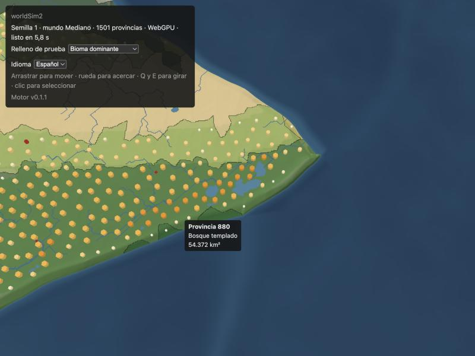
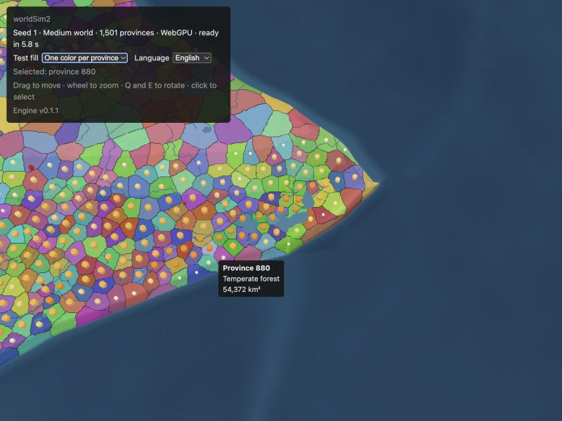
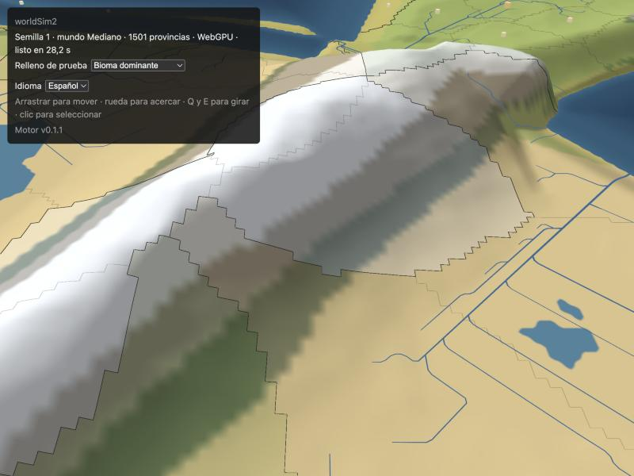

# P1.2 · Mapa v1 — implementación y mediciones

| | |
|---|---|
| **Fecha** | 2026-10-16 |
| **Tarea** | P1.2 del [BRIEF de P1](BRIEF.md) (§4) |
| **Código** | `apps/web/src/worker/` (host del Worker de worldgen) · `apps/web/src/map/` (renderer, capas, picking, medición) · `apps/web/src/MapScreen.tsx` |
| **Rama** | `claude/eager-lamport-065b7b` (cortada de `phase/p01-rebanada` en 115306d) |
| **Estado** | Hecha y medida en headless. **Faltan** las mediciones visibles de Cristian (checkpoint 1, §8) |

## 1. Resumen
- **Primera carga del mundo mediano (M1 Pro, build, dpr 2, headless):**
  - Chrome · WebGPU: **4,3–4,7 s** hasta el primer cuadro terminado en la GPU;
  - Chrome · WebGL2 forzado: 4,5–5,3 s;
  - Firefox 137 · WebGL2 (fallback automático): 7,3–7,6 s.
- **Casi todo es worldgen en el Worker:** 3,8–4,1 s en Chrome y 6,4 s en Firefox (3,6 s en Node).
  El render agrega 0,3–0,4 s en Chrome y 0,6–0,9 s en Firefox.
- **Sin congelamientos después del primer cuadro** en ninguna corrida (cuadro máximo de los 5 s
  siguientes: 16,8 ms en Chrome, 18–22 ms en Firefox). El congelamiento de 8 s de Firefox de P0
  **no se reproduce en headless**: hay que confirmarlo en Firefox visible (§8).
- **Recorrido de 60 s:**
  - Chrome: 60,0 fps (p5 59,9) con los dos backends, cola de GPU en 1;
  - Firefox: 59,3 fps (p5 57,1), con 19 tirones (máx. 183 ms).
- **Margen por estrés:** WebGPU sostiene ×8 escenas por cuadro y satura entre ×8 y ×12; WebGL2
  sostiene ×3 y satura en ×4. Los dos mejoran al spike A (≈ ×8 y ×2–×3).
- **Hallazgo (L-018):** con la caché de shaders fría, `render()` vuelve enseguida pero la GPU sigue
  compilando pipelines. Medido por CPU, el "primer cuadro" aparecía antes de verse, seguido de un
  cuadro de 967 ms. Ahora la carga espera a que la GPU termine, y la medición queda honesta.

## 2. Qué se hizo
- **Host del Worker de worldgen** (`worker/`):
  - `worldgen.worker.ts` llama a `generateWorld` con progreso por etapa y devuelve el
    `WorldStatic` con `transferables(world)`;
  - `WorldgenClient`: una promesa por pedido + callback de progreso, rechazo si el Worker falla,
    `dispose()`;
  - mide `generateMs` (en el Worker), `transferMs` (con reloj absoluto) y `wallMs`;
  - **Δ de P1.1 cumplida:** nada se genera en el hilo principal.
- **Renderer** (`map/`, enfoque del spike A, D43):
  - `WebGPURenderer` + TSL, fallback automático a WebGL2 y `?backend=webgl2`;
  - grilla compartida por LOD (5 niveles), desplazamiento en el vertex shader y normales en el
    fragment;
  - faldones, esfera envolvente a mano, chunks de 128 celdas reposicionados para el wrap E-O,
    cámara envuelta a [0, ancho);
  - precalentado con UN render sincrónico con todo visible;
  - exageración vertical como parámetro (`?exaggeration=`, `setVerticalExaggeration`).
- **Texturas** (datos puros en `textures.ts`, 21 MB en el mediano):
  - altura **RG16F**: elevación + máscara de lago;
  - superficie RGBA8 con el color del bioma premultiplicado por la tierra;
  - ids de provincia RG8 (NEAREST);
  - tabla de colores por provincia RGBA8 (256 × 6 texels).
- **Capas:**
  - color por bioma con sombreado;
  - agua por profundidad, con los lagos aparte;
  - costa por el cruce por cero de la elevación;
  - **ríos** como cintas con ancho por caudal (escala log, 1–4,5 px), trazados siguiendo `flowDir`
    desde las celdas con caudal ≥ 50 m³/s, con una pasada de Chaikin y repartidos por columna de
    chunks para el wrap;
  - **relleno y fronteras:** frontera de provincia = ids distintos; frontera política = colores
    distintos (se comparan los texels vecinos a ~1,5 px de pantalla).
- **API para P1.3/P1.6:**
  - `setProvinceColors(rgba)`: (provincias + 1) × RGBA8; cambiar de año = reescribir ≈ 6 KB;
  - `colorFromSeed(seed)` para el `colorSeed` de las polities;
  - `setSettlements([{x, y, level}])` y `setBattles([{x, y, recency}])`;
  - `onHover(pick)` y `onSelect(provincia)`.
- **Modos de prueba del relleno:** bioma dominante (por defecto), un color por id, sin relleno.
- **Zoom semántico v0:**
  - de lejos: plano, relleno al 78 %, sombreado mínimo, solo los ríos grandes, sin fronteras de
    provincia;
  - de cerca: relieve completo, relleno al 28 %, todos los ríos y las fronteras de provincia.
- **Marcadores instanciados:**
  - `mesh.count` + `instancedBufferAttribute`;
  - la X se lleva a la copia más cercana a la cámara en el shader;
  - tamaño en px con tope en celdas;
  - datos de prueba: 944 asentamientos y 15 batallas en el mediano.
- **Picking en CPU:**
  - rayo de cámara contra el relieve dibujado: marcha + bisección sobre la misma altura que la GPU
    (bilineal, `max(elev, 0)`, exageración × relieve);
  - después, la celda del ráster (con wrap) → provincia;
  - tooltip con id, bioma (`content.biome.*`) y área; clic = selección resaltada.
- **UI neutra en la app placeholder:**
  - `?seed=` (número o texto), `?size=`, `?map=`, `?land=`;
  - progreso como texto plano, toggle es/en, selector del relleno de prueba;
  - claves i18n nuevas solo bajo `map.`.
- **Medición:**
  - `window.__map` (`MapReport`): tiempos de carga desglosados, cuadros de los 5 s posteriores,
    memoria, escena, recorrido;
  - `?tour=1` (60 s, `?duration=`) y `?repeat=N`;
  - `apps/web/scripts/measure-map.mjs`: Chrome por CDP, Firefox por WebDriver BiDi, sin
    dependencias; corridas `cold` / `reload` / `restart`, capturas y consola.
- **Tests (Vitest, 53):**
  - wrap y LOD;
  - picking (id correcto por coordenada de mundo con wrap, rayo contra una meseta, rayo a través de
    la costura);
  - texturas de ids (16 bits, dilatación con wrap) y tabla de colores (texel por id);
  - altura y superficie;
  - ríos: confluencias, salidas de lagos, costura y, en un mundo real, cada celda de río una vez
    siguiendo su `flowDir` sin subir;
  - cintas por columna en la costura;
  - zoom semántico, colores, parámetros, marcadores, métricas, recorrido;
  - protocolo y cliente del Worker.
- **Validación por mutación (L-004):** 13 mutaciones, **todas detectadas**:
  - wrap de `cellAt`, `nearestCopyX` con `floor`, bilineal sin wrap;
  - byte alto del id, tabla corrida, dilatación sin wrap;
  - X de los ríos envuelta, confluencias sin cortar, cintas sin el x0 de la columna;
  - rayo desde el suelo, id equivocado en el cliente, relieve invertido, color de bioma corrido.

## 3. Cómo se midió
- **Máquina:** MacBook Pro M1 Pro (GPU de 14 núcleos), macOS 26.0.
- **Build de producción** (`vite build` + `vite preview` en el puerto 4176; L-009). Mundo mediano,
  seed 1, continentes, tierra 0,30 (hash `8e1d8e0019598fab`, 1.501 provincias).
- **Navegadores headless** con `measure-map.mjs`: Chrome 155 (`--headless=new`) y Firefox 137
  (`--headless`), ventana de 1512×945 y `?dpr=2` (canvas de 3024×1716 en Chrome y 3024×1890 en
  Firefox), MSAA 4×.
- **Por qué headless:** el panel del navegador integrado estaba oculto:
  - `requestAnimationFrame` corre a ~1,5 fps;
  - el Worker también va más lento: la misma carga tarda 13–28 s.

  Las capturas sí salen del integrado (§7).
- **Corridas de carga:**
  - `cold`: perfil nuevo, sin caché HTTP ni de shaders;
  - `reload`: misma sesión, caché en memoria y en disco;
  - `restart`: mismo perfil con el navegador reiniciado, solo caché en disco.
- **Primer cuadro** = desde el inicio de la navegación hasta que la GPU terminó el primer cuadro
  (`onSubmittedWorkDone` en WebGPU, fence en WebGL2) + un `requestAnimationFrame`.
- **Asentamiento:** los cuadros de los 5 s siguientes (detecta congelamientos de la carga).
- **fps:**
  - headless tiene un reloj virtual de 60 Hz;
  - control cruzado con la cola de GPU (L-010): si los cuadros en vuelo quedan en 1–2, la GPU da
    abasto;
  - margen por estrés (`?repeat=N`, recorridos de 20 s).

## 4. Primera carga (mundo mediano, dpr 2)
Tiempos en ms.

| Navegador · backend | Corrida | **Primer cuadro** | Init renderer | Worldgen (Worker) | Datos del mapa (CPU) | Precalentado CPU / GPU | Máx. de los 5 s siguientes · tirones |
|---|---|---|---|---|---|---|---|
| Chrome · WebGPU | cold | **4.697** | 44 | 4.008 | 169 | 78 / 109 | 16,8 · 0 |
| Chrome · WebGPU | reload | **4.319** | 34 | 3.789 | 167 | 70 / 111 | 16,8 · 0 |
| Chrome · WebGPU | restart | **4.536** | 201 | 3.811 | 164 | 69 / 114 | 16,8 · 0 |
| Chrome · WebGL2 forzado | cold | **5.216** | 28 | 3.914 | 168 | 751 / 29 | 16,8 · 0 |
| Chrome · WebGL2 forzado | reload | **4.514** | 9 | 3.973 | 167 | 82 / 71 | 16,8 · 0 |
| Chrome · WebGL2 forzado | restart | **5.255** | 336 | 3.828 | 170 | 699 / 28 | 16,8 · 0 |
| Firefox 137 · WebGL2 | cold | **7.622** | 69 | 6.392 | 262 | 403 / 54 | 22,4 · 0 |
| Firefox 137 · WebGL2 | reload | **7.323** | 14 | 6.499 | 303 | 282 / 23 | 18,0 · 0 |
| Firefox 137 · WebGL2 | restart | **7.330** | 26 | 6.403 | 265 | 249 / 20 | 19,3 · 0 |

Lectura:
- **El worldgen manda** (85–90 % de la carga). El renderer se inicializa en paralelo (`MapSession`)
  y queda escondido detrás del worldgen.
- **Transferencia del mundo:** 0–2 ms (buffers transferidos, sin copia).
- **El precalentado de WebGL2 con la caché fría cuesta 0,4–0,75 s** (compilación de shaders vía
  ANGLE/Metal en Chrome); en caliente baja a 80 ms en Chrome. WebGPU: ~180 ms entre CPU y GPU.
- **Antes de esperar a la GPU** (primera ronda, misma build salvo eso), un `restart` de Chrome dio:
  - init de WebGPU de 3.197 ms (en paralelo al worldgen);
  - **un cuadro de 967 ms justo después del "primer cuadro"**: compilación de pipelines en la GPU.

  Es el mismo fenómeno que los +3,5 s de init en frío del spike A y la hipótesis más fuerte para el
  congelamiento de 8 s de Firefox visible. Ver L-018.
- **Datos del mapa en el hilo principal:** 165–300 ms (texturas + ríos), un bloqueo único antes
  del primer cuadro. Si molesta, se puede mover al Worker (los módulos son puros).

## 5. Recorrido de 60 s (dpr 2)
El recorrido cruza la costura dos veces, alterna cerca y lejos (LOD y zoom semántico en los dos
sentidos) y recorre latitudes.

| Navegador · backend | fps prom / p5 / p1 | Cuadro máx. (ms) | Tirones > 25 ms | CPU prom / p95 (ms) | Cola GPU prom (máx.) |
|---|---|---|---|---|---|
| Chrome · WebGPU | 60,0 / 59,9 / 59,5 | 16,8 | 0 | 1,10 / 2,4 | 1,00 (3) |
| Chrome · WebGL2 forzado | 60,0 / 59,9 / 59,5 | 16,8 | 0 | 1,15 / 2,7 | 1,00 (2) |
| Firefox 137 · WebGL2 | 59,3 / 57,1 / 56,6 | 182,8 | 19 | 1,86 / 5,0 | 1,26 (3) |

**Margen por estrés** (Chrome, dpr 2, 20 s):

| Escenas por cuadro | WebGPU: fps prom / p1 · cola prom (máx.) | WebGL2: fps prom / p1 · cola prom (máx.) |
|---|---|---|
| ×2 | — | 60,0 / 59,5 · 1,01 (2) |
| ×3 | — | 60,0 / 59,5 · 1,09 (2) |
| ×4 | 60,0 / 59,5 · 1,04 (2) | **54,8** / 29,9 · 4,99 (6), 101 tirones |
| ×8 | 60,0 / 59,5 · 1,04 (3) | — |
| ×12 | **37,9** / 29,9 · 5,15 (7) | — |
| ×16 | 30,4 / 20,0 · 5,08 (6) | — |

Una escena cuesta del orden de **1,5–2 ms de GPU con WebGPU** y **4–5 ms con WebGL2**:
- a 120 Hz (8,3 ms por cuadro), WebGPU tiene margen de sobra;
- WebGL2 entra justo (~1,7×).

El preset "fallback" con dpr ≤ 1,5 del ADR-006 sigue siendo la mitigación barata.

## 6. Memoria y escena (mediano)

| Recurso | Tamaño |
|---|---|
| Altura RG16F 2048×1024 | 8,0 MB |
| Superficie RGBA8 | 8,0 MB |
| Ids de provincia RG8 | 4,0 MB |
| Tabla de colores (256×6 RGBA8) | 6 KB |
| Ríos: 10.687 líneas, 344.648 vértices (posición, inglete, caudal, índices) | 12,1 MB |
| Terreno: 5 grillas compartidas | 0,57 MB |
| Lo que cuenta `renderer.info.memory` (texturas, con render targets) | 36,5 MB |

- **Escena:** 128 chunks activos (de 640 mallas: una por LOD y por chunk, antes del descarte por
  frustum), 16 columnas de ríos y 2 mallas instanciadas.
- **Bundle:** 1,29 MB (369 KB gzip), casi todo three; el Worker de worldgen pesa 130 KB. Vite
  avisa por el tamaño del chunk: queda para P13 (separar three en su propio chunk).

## 7. Capturas (navegador integrado, panel oculto)
- `img/mapa-p12-hover-es.jpg`: encuadre inicial en la provincia más habitable, relleno por bioma
  dominante, ríos, lagos, marcadores y tooltip.
- `img/mapa-p12-ids-en.jpg`: inglés, un color por provincia (fronteras políticas en todas) y
  provincia seleccionada.
- `img/mapa-p12-relieve.jpg`: de cerca, relieve exagerado ×30 con sombreado, fronteras de provincia,
  un lago interior y ríos.

  El "listo en 28,2 s" de esa captura es el panel oculto (estrangulado), no el tiempo real.

## 8. Mediciones que le voy a pedir a Cristian (checkpoint 1)
En el preview desplegado (o `pnpm --filter @ws/web build && pnpm --filter @ws/web preview`), con la
ventana **visible**:

1. **Chrome:**
   - cerrar Chrome del todo, abrirlo y cargar la URL del preview (caché fría);
   - anotar el "listo en X s" del panel;
   - después recargar con Cmd+R (caché caliente) y anotar de nuevo.
2. **Firefox:** lo mismo, y además:
   - anotar el **backend** que muestra el panel (WebGPU desde Firefox 147; con la 137 instalada
     sale WebGL2);
   - anotar si hay un congelamiento después de que aparece el mapa (el riesgo de P0).
3. **Safari**, **sin modo de bajo consumo**: lo mismo.
4. **En cada uno**, con la consola abierta, copiar el reporte:
   - `copy(JSON.stringify(__map))` en Chrome y Firefox;
   - en Safari, `JSON.stringify(__map)` y copiar el resultado;
   - `load.firstFrameAt` es el tiempo hasta el primer cuadro y `settle.frameMsMax`, el peor cuadro
     de los 5 s siguientes.
5. **Opcional (fps):** abrir la URL con `?tour=1`, esperar 60 s sin tocar nada y copiar
   `__map.tour`.

## 9. Δ y decisiones técnicas (para el REPORT)
- **Altura RG16F (elevación + máscara de lago)** en vez de R16F: la elevación filtrada no distingue
  un lago de una costa de mar (tierra +500 m y mar −10 m promedian positivo); +4 MB.
- **Costa por elevación, no por máscara binaria:**
  - el cruce por cero de un campo continuo da una costa suave;
  - la máscara filtrada de tierra/agua dejaba escalones de una celda;
  - la máscara de lago se usa solo para las orillas de los lagos.
- **Ids dilatados 2 celdas hacia el agua** (solo en la textura; el picking usa el ráster): el
  relleno llega hasta la costa suave sin cortarse en escalera.
- **Picking por rayo contra el relieve** y no contra el plano: con ×30, una montaña tiene ~10 celdas
  de alto y un plano y = 0 erraría la provincia en vistas oblicuas.
- **Ríos como cintas por columna de chunks:**
  - cada tramo va a la columna de su punto medio, y la columna se reposiciona como un chunk;
  - ancho en px por caudal con tope en celdas;
  - elevación extra con la distancia para que el LOD grueso no tape los valles;
  - las dos caras: el sentido de los triángulos depende del lado (L-021).
- **Primer cuadro = GPU terminada** (L-018): el reporte desglosa `warmupMs` (CPU) y `gpuWarmupMs`.
- **Encuadre inicial:** el centroide de la provincia más habitable (el centro del mapa caía en el
  océano).
- **`.claude/launch.json` suma `web-build`** (`vite preview` en el puerto 4176). `preview_start` no
  lo pudo levantar en esta sesión (error `getcwd` del sandbox, igual que en P0): se levantó por
  Bash en segundo plano (L-019).

## 10. Limitaciones conocidas (no se tocan en P1: P2/P12)
- **Bordes a resolución de celda (~20 km):**
  - las fronteras (ids NEAREST) y las transiciones de bioma se ven en escalera de cerca;
  - para P12: SDF de fronteras o ruido en el shader.
- **Zoom máximo limitado:** cada chunk existe una sola vez, así que el plano lejano tiene que
  quedar por debajo de medio mundo y de lejos se ven ~900×500 celdas, no el planeta entero. Para
  el "atlas" completo (D5) hacen falta copias de chunks en el zoom más lejano.
- **Datos de prueba:**
  - los 944 asentamientos de prueba saturan el mapa; los reales (P1.3) son menos y por nivel;
  - la densidad de ríos con 50 m³/s es alta de cerca.
- **Aviso de three en Firefox 137:** "WebGPU is not available, running under WebGL2 backend" sale
  como `warn` en la consola. No es un error; si molesta para "cero errores de consola", se
  silencia al detectar el backend.
